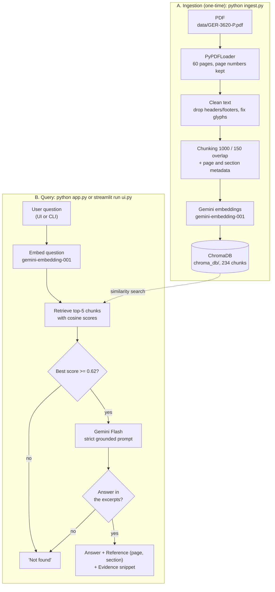
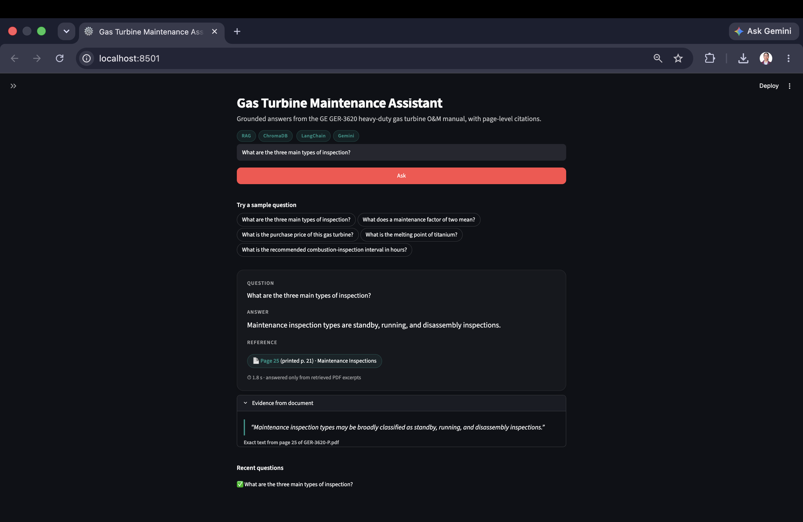
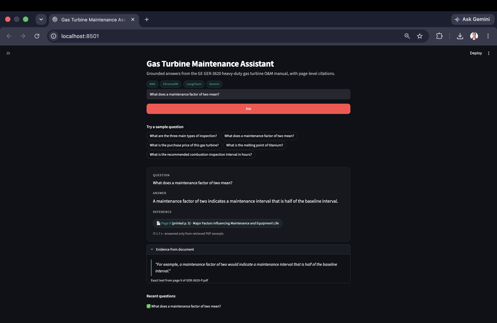
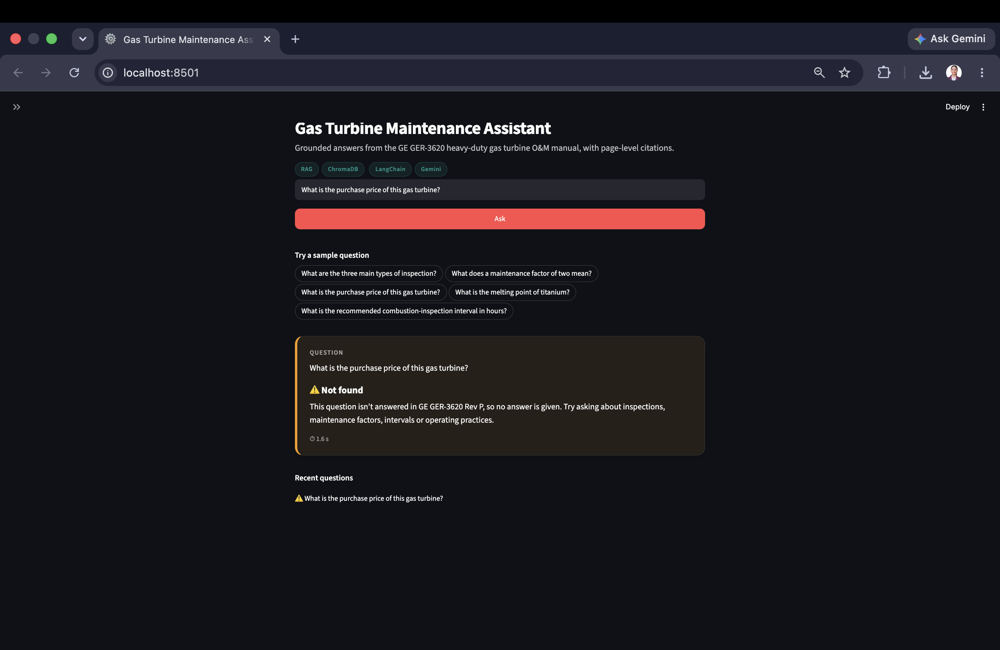
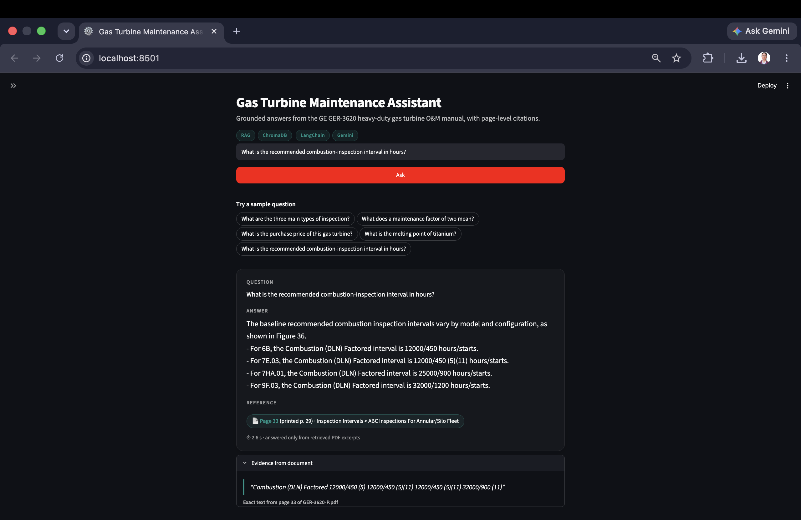

# Gas Turbine Maintenance Assistant (RAG)

Ask questions about **GE GER-3620 Rev P – Heavy-Duty Gas Turbine Operating and Maintenance Considerations** (60-page PDF) and get answers taken **only** from the document, each with page, section and an exact evidence snippet, or exactly `Not found`.

## How it works



**Ingestion (run once)**
1. Load the PDF with `PyPDFLoader`; every page keeps its page number.
2. Clean the text: remove the repeated header/footer and bare page numbers, decode broken figure glyphs.
3. Find section headings: short title lines that match an entry of the PDF's own table of contents.
4. Cut each page at its headings, then split into ~1000-character chunks (150 overlap) tagged with page, printed page and section.
5. Embed the chunks with Gemini in batches of 20, retrying automatically on rate limits.
6. Store the vectors in a local ChromaDB folder (`chroma_db/`).

**Answering a question**

7. The user asks a question in the web UI or the CLI.
8. The question is embedded with the same Gemini model.
9. ChromaDB returns the 5 most similar chunks with their similarity scores.
10. If even the best score is below 0.62, the question is off-topic: reply `Not found` without calling the LLM.
11. Otherwise Gemini Flash gets the 5 chunks and a strict prompt: use only these excerpts, else say `Not found`.
12. The code builds the reference (page + section) from the cited chunks and checks the evidence quote really exists in them.

### Project structure

```
├── ingest.py          # PDF -> clean -> section-aware chunks -> Gemini embeddings -> ChromaDB
├── rag.py             # ask(): retrieve top-k, score threshold, strict prompt, reference + evidence
├── app.py             # CLI: one question, or the 5 test questions
├── ui.py              # Streamlit web UI (only calls rag.ask)
├── config.py          # paths, model names, vector-store factory, loads .env
├── data/              # put GER-3620-P.pdf here (download from the LMS; not in the repo)
├── screenshots/       # q1.png ... q5.png
├── chroma_db/         # generated by ingest.py (git-ignored)
├── requirements.txt   # pinned, tested versions
└── .env.example       # copy to .env and add GOOGLE_API_KEY
```

## Tech stack

| Part | Choice |
|---|---|
| Language | Python 3 (tested on 3.14) |
| Framework | LangChain (`langchain-core`, `langchain-community`, `langchain-text-splitters`) |
| PDF loading | `PyPDFLoader` (pypdf) |
| Embeddings | Google `gemini-embedding-001` via `langchain-google-genai` |
| Chat model | `gemini-3.5-flash-lite`; falls back to `gemini-3.5-flash`, then `gemini-3.1-flash-lite` |
| Vector DB | ChromaDB (`langchain-chroma`), persisted locally, cosine similarity |
| UI | Streamlit + custom CSS |

Model notes (checked Oct 2026): `gemini-2.5-flash` is closed to new API keys. `gemini-3.7-flash` and `gemini-3.8-flash` timed out (HTTP 504). `gemini-embedding-2` merges a batch of texts into a single vector, so `gemini-embedding-001` is used. Both models can be changed in `.env`.

## Setup and run

**Get the PDF first:** download `GER-3620-P.pdf` from the LMS and save it as `data/GER-3620-P.pdf`. The PDF is not included in this repo.

```bash
python3 -m venv venv
source venv/bin/activate              # Windows: venv\Scripts\activate
pip install -r requirements.txt
cp .env.example .env                  # then put your GOOGLE_API_KEY in .env (never commit it)

python ingest.py                      # one-time: builds chroma_db/ (~2.5 min on the free tier)
python app.py                         # runs the 5 test questions
python app.py "How often should lube oil be sampled?"   # any single question
streamlit run ui.py                   # web UI at http://localhost:8501
```

## Web UI

`streamlit run ui.py`
- Header with project name, subtitle and badges (RAG, ChromaDB, LangChain, Gemini).
- Sidebar with what the project is, the source document, how it works in 4 steps, and the number of chunks indexed.
- Large question box with an **Ask** button, plus 5 sample-question chips that ask immediately when clicked.
- Answer card showing the answer, a reference pill (page + section), a "Evidence from document" panel with the exact snippet and its page, and the response time.
- A clear warning card for `Not found`, and a "Searching the manual..." spinner while the answer is generated.
- **Recent questions**: click one to view its answer again without a new API call.
- Works in light and dark themes and on phones (below 768 px: smaller text, stacked chips, full-width cards, no sideways scrolling).

## Results

The "Actual" column is copied from a real `python app.py` run (23 Oct 2026, `gemini-3.5-flash-lite`; Q5's bullets joined into one line). The "Expected" column was checked against the PDF text. "Page" is the PDF page number shown in a PDF viewer; "printed p." is the number printed on the page itself (the PDF starts with cover and contents pages).

| # | Question | Expected (accepted) answer | Actual system answer | Reference (page/section) | Screenshot |
|---|---|---|---|---|---|
| 1 | What are the three main types of inspection? | Standby, running and disassembly inspections (disassembly goes from combustion to hot gas path to major). Page 25 (printed p. 21), "Maintenance Inspections" | Maintenance inspections may be broadly classified as standby, running, and disassembly inspections. | Page 25 (printed p. 21), Section "Maintenance Inspections" | [q1.png](screenshots/q1.png) |
| 2 | What does a maintenance factor of two mean? | The maintenance interval is half of the baseline interval. Page 9 (printed p. 5) | A maintenance factor of two would indicate a maintenance interval that is half of the baseline interval. | Page 9 (printed p. 5), Section "Major Factors Influencing Maintenance and Equipment Life" | [q2.png](screenshots/q2.png) |
| 3 | What is the purchase price of this gas turbine? | Not found | Not found | – | [q3.png](screenshots/q3.png) |
| 4 | What is the melting point of titanium? | Not found | Not found | – | [q4.png](screenshots/q4.png) |
| 5 | What is the recommended combustion-inspection interval in hours? | Depends on model and combustor (Figure 36, base load, natural gas, dry): 8,000–32,000 factored hours, e.g. 7E.03 8,000 (non-DLN) / 12,000 (DLN), 7F.03 24,000, 7HA/9HA 25,000; divide by the maintenance factor (p. 36). Page 33 (printed p. 29) | The recommended baseline combustion inspection intervals vary by model and configuration as shown in Figure 36. – For 6B.03, the Combustion (DLN) Factored interval is 12000/450 hours/starts. – For 7F.03, the Combustion (DLN) Factored interval is 24000/900 hours/starts. – For 7HA.01, the Combustion (DLN) Factored interval is 25000/900 hours/starts. | Page 33 (printed p. 29), Section "Inspection Intervals > ABC Inspections For Annular/Silo Fleet" (Figure 36) | [q5.png](screenshots/q5.png) |

<details>
<summary>Output of <code>python app.py</code> (separator lines removed)</summary>

```
Q1 Question : What are the three main types of inspection?
Answer   : Maintenance inspections may be broadly classified as standby, running, and disassembly
           inspections.
Reference: Page 25 (printed p. 21), Section "Maintenance Inspections"
Evidence : "Maintenance inspection types may be broadly classified as standby, running, and
           disassembly inspections." (page 25)

Q2 Question : What does a maintenance factor of two mean?
Answer   : A maintenance factor of two would indicate a maintenance interval that is half of the
           baseline interval.
Reference: Page 9 (printed p. 5), Section "Major Factors Influencing Maintenance and Equipment Life"
Evidence : "a maintenance factor of two would indicate a maintenance interval that is half of the
           baseline interval." (page 9)

Q3 Question : What is the purchase price of this gas turbine?
Answer   : Not found
Reference: -

Q4 Question : What is the melting point of titanium?
Answer   : Not found
Reference: -

Q5 Question : What is the recommended combustion-inspection interval in hours?
Answer   : The recommended baseline combustion inspection intervals vary by model and configuration
           as shown in Figure 36.
           - For 6B.03, the Combustion (DLN) Factored interval is 12000/450 hours/starts.
           - For 7F.03, the Combustion (DLN) Factored interval is 24000/900 hours/starts.
           - For 7HA.01, the Combustion (DLN) Factored interval is 25000/900 hours/starts.
Reference: Page 33 (printed p. 29), Section "Inspection Intervals > ABC Inspections For Annular/Silo
           Fleet"
Evidence : "Combustion (DLN) Factored 12000/450 (5) 12000/450 (5)(11) 12000/450 (5)(11) 32000/900
           (11)" (page 33)
```
</details>

## Screenshots

Taken in the Streamlit UI. This was a separate run from the CLI table above, so the wording differs slightly. Note: in the Q5 screenshot the model gave `32000/1200` for 9F.03, but in Figure 36 that value belongs to 9F.04 (9F.03 is `24000/900`). This is the table-extraction limitation described under Feasibility; the other values shown are correct.

| Q1 | Q2 |
|---|---|
|  |  |
| **Q3** | **Q4** |
|  |  |
| **Q5** | |
|  | |

## Grounding

- Answers come **only from the retrieved PDF chunks** (top 5). The prompt forbids outside knowledge, even facts the model knows.
- Every answer shows **page + section + an evidence snippet**. The reference is built by the code from chunk metadata, not typed by the LLM, so page numbers cannot be made up.
- The evidence is **checked**: the model's quote must appear word for word (ignoring spacing) in a retrieved chunk. If it doesn't, the matching line from the cited chunk is shown instead, so the snippet is always real PDF text.
- **Out-of-document questions return exactly `Not found`**, with no reference and no evidence.

## How "Not found" is handled

There are two layers of protection:

1. **Score threshold (before the LLM).** The cosine similarity of the best chunk must be at least `0.62`. In-document questions scored 0.71–0.81; off-topic ones scored 0.53–0.60 (titanium 0.598, "president of France" 0.529). Below the threshold the app replies `Not found` immediately, with no LLM call.
2. **Strict prompt (after retrieval).** Some questions sound related but aren't answered by the document. Q3 ("purchase price", score 0.690) matched general turbine text, but the excerpts contain no price, so the model replied exactly `Not found`.

| Question | Best score | Decided by |
|---|---|---|
| Q1 three inspection types | 0.710 | answered |
| Q2 maintenance factor of two | 0.747 | answered |
| Q3 purchase price | 0.690 | strict prompt, so `Not found` |
| Q4 melting point of titanium | 0.598 | threshold, so `Not found` (LLM not called) |
| Q5 combustion-inspection interval | 0.810 | answered |

Nothing is hard-coded: all five answers come from the same retrieve-then-answer pipeline.

## Feasibility

- **Hardware:** runs on a normal laptop with CPU only (tested on macOS, Python 3.14).
- **Cost:** uses the free Gemini API tier. ChromaDB is local files (~8 MB), so there is no server cost.
- **Ingestion:** one-time, 234 chunks, about 2.5 minutes on the free tier including rate-limit retries.
- **Answer time:** about 2 s per question with `gemini-3.5-flash-lite` (the 5 test questions took 9 s in total). Off-topic questions are rejected in under 1 s.
- **Limitations:**
  - Needs internet access and an API key. The free tier allows about 20 chat requests per day per model, which is why there is a fallback chain.
  - Text inside images or scanned figures is not extracted.
  - Table layout is partly lost. Blank cells disappear, so a value can be read in the wrong column; for example, in the Figure 36 "6F" row, 8,000 belongs to 6F.03 but can be read as 6F.01.
  - Section detection relies on the PDF's table of contents.
  - Answer wording can vary slightly between runs.
- **Scaling:** to add more PDFs, loop over files in `ingest.py` (every chunk already stores its `source`). Swap models through `.env` (`GEMINI_CHAT_MODEL`, `GEMINI_EMBED_MODEL`). For large collections, move to a ChromaDB server or a managed vector database and add a reranker.
